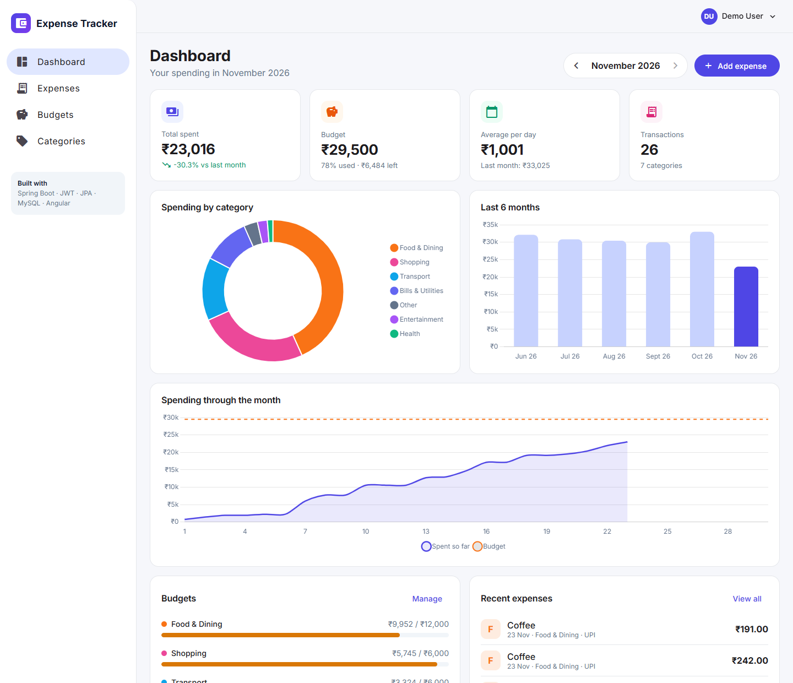
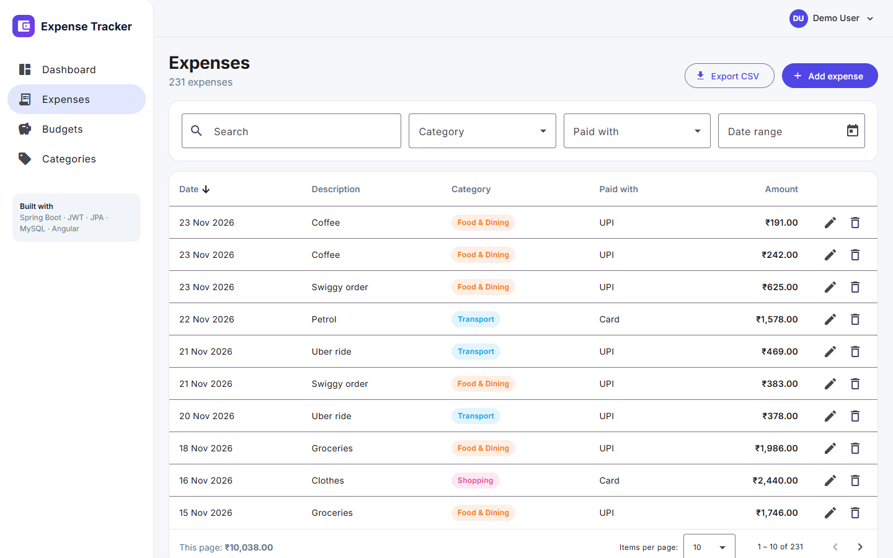
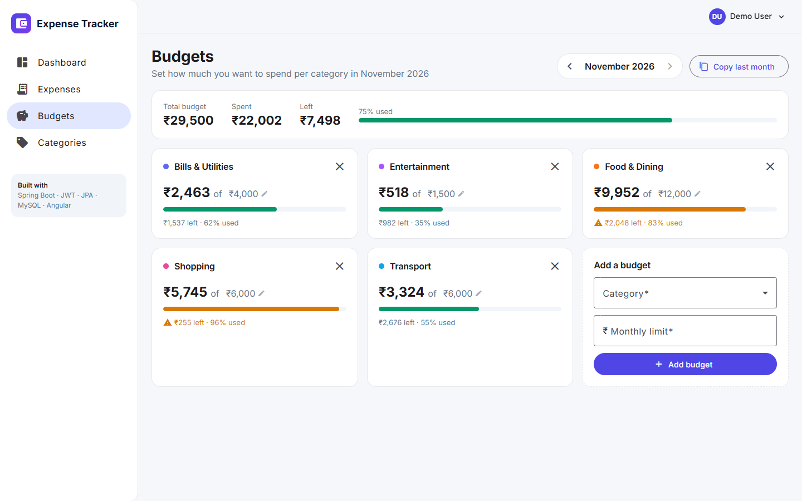
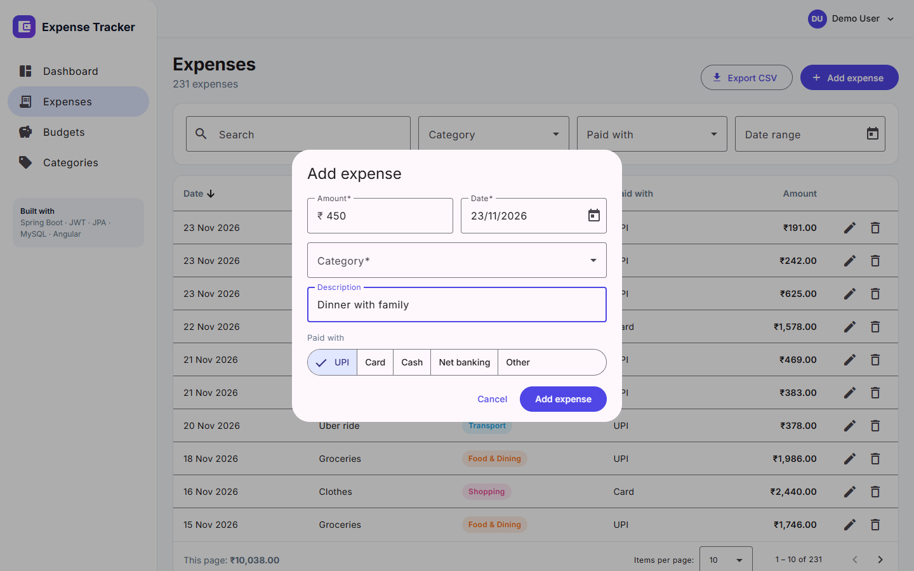
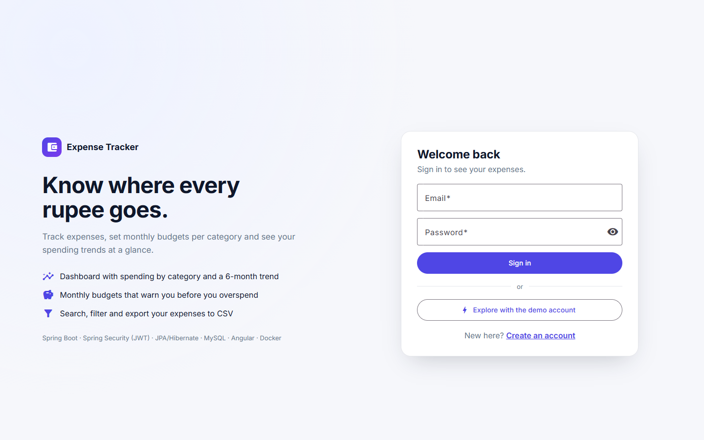
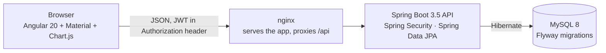

# Expense Tracker

[](https://github.com/SushilAmbekar/expense-tracker-fullstack/actions/workflows/ci.yml)
[](https://sushilambekar.github.io/expense-tracker-fullstack/)


A full-stack personal finance app: record expenses, set a monthly budget per category and see where the money goes.
**Spring Boot REST API** secured with **JWT**, **JPA/Hibernate** on **MySQL** with **Flyway** migrations,
and an **Angular** frontend with charts. Runs with one `docker compose up`.

**[▶ Try the live demo](https://sushilambekar.github.io/expense-tracker-fullstack/)**: click *Explore with the demo account*. Nothing to install.



## Features

- **Accounts:** register and sign in. Passwords are hashed with BCrypt; the API is stateless and checks a signed JWT on every request.
- **Expenses:** add, edit and delete. Search the description and filter by category, payment method (UPI, card, cash, net banking) and date range. Sortable, paged table. **Export the filtered list to CSV.**
- **Categories:** 9 ready-made categories for every new user; add your own with a colour.
- **Budgets:** a monthly limit per category with a progress bar that turns orange at 80% and red when you overspend. Copy last month's budgets in one click.
- **Dashboard:** total spent and change from last month, budget used, average per day, spending by category, the last 6 months, and spending through the month against the budget.
- **Privacy by design:** every query is scoped to the signed-in user. Another user's data returns 404, as if it does not exist.

| Expenses | Budgets |
| --- | --- |
|  |  |
| **Add expense** | **Sign in** |
|  |  |

## Architecture



The backend is organised by feature (`user`, `expense`, `category`, `budget`, `analytics`), each with its controller, service, repository and DTOs:

```
backend/src/main/java/com/sushilambekar/expensetracker
├── security/    JWT issuing and validation, SecurityConfig, @CurrentUserId resolver
├── user/        Register, login, current user
├── expense/     CRUD, JPA Specifications for filters, CSV export, aggregate queries
├── category/    Per-user categories and defaults
├── budget/      Monthly budgets, spent vs limit, copy month
├── analytics/   Monthly summary and trend
├── common/      RFC 7807 error handling, paged responses
└── demo/        Optional demo account with sample data
```

## Tech stack

| Layer | Technology |
| --- | --- |
| Backend | Java 17, Spring Boot 3.5, Spring Web, Spring Security (OAuth2 resource server, HS256 JWT), Bean Validation |
| Data | Spring Data JPA, Hibernate, MySQL 8, Flyway |
| API docs | springdoc-openapi (Swagger UI) |
| Frontend | Angular 20 (standalone components, signals), Angular Material, Chart.js, RxJS |
| Testing | JUnit 5, Mockito, MockMvc, H2, Jasmine/Karma |
| DevOps | Docker (multi-stage builds), Docker Compose, nginx, GitHub Actions, GitHub Pages |

## Run it

### With Docker (recommended)

```bash
git clone https://github.com/SushilAmbekar/expense-tracker-fullstack.git
cd expense-tracker-fullstack
docker compose up --build
```

| What | Where |
| --- | --- |
| App | http://localhost:4200 (demo account: `demo@expense-tracker.dev` / `demo12345`) |
| API docs (Swagger UI) | http://localhost:8080/swagger-ui.html |
| Health | http://localhost:8080/actuator/health |

Set `JWT_SECRET` (at least 32 characters) and `DB_PASSWORD` in the environment for anything beyond local use, and `DEMO_DATA_ENABLED=false` to start without the demo account.

### Without Docker

Requirements: Java 17, Node 20+, MySQL 8.

```bash
# Backend on http://localhost:8080 (creates the expense_tracker database if needed)
cd backend
DB_USERNAME=root DB_PASSWORD=yourpassword DEMO_DATA_ENABLED=true ./mvnw spring-boot:run

# Frontend on http://localhost:4200, proxying /api to the backend
cd frontend
npm install
npm start
```

## API

All endpoints except register and login need `Authorization: Bearer <token>`. Errors use [RFC 7807](https://www.rfc-editor.org/rfc/rfc7807) problem details, with an `errors` map for invalid fields.

| Method | Endpoint | Description |
| --- | --- | --- |
| `POST` | `/api/auth/register` | Create an account, returns a token |
| `POST` | `/api/auth/login` | Sign in, returns a token |
| `GET` | `/api/auth/me` | The signed-in user |
| `GET` | `/api/expenses` | List with `from`, `to`, `categoryId`, `paymentMethod`, `q`, `page`, `size`, `sortBy`, `direction` |
| `GET` | `/api/expenses/export` | The same filters, as a CSV download |
| `POST` `GET` `PUT` `DELETE` | `/api/expenses/{id}` | Create, read, update, delete an expense |
| `GET` `POST` `PUT` `DELETE` | `/api/categories/{id}` | Manage categories |
| `GET` `PUT` | `/api/budgets?month=2026-11` | List or set a month's budgets |
| `POST` | `/api/budgets/copy?from=2026-10&to=2026-11` | Copy budgets to another month |
| `GET` | `/api/analytics/summary?month=2026-11` | Totals, change, average per day, by category, by day |
| `GET` | `/api/analytics/trend?end=2026-11&months=6` | Monthly totals |

Example:

```bash
TOKEN=$(curl -s -X POST localhost:8080/api/auth/login -H 'Content-Type: application/json' \
  -d '{"email":"demo@expense-tracker.dev","password":"demo12345"}' | jq -r .token)

curl -s "localhost:8080/api/expenses?q=coffee&sortBy=AMOUNT&direction=DESC&size=5" -H "Authorization: Bearer $TOKEN"
```

## Engineering notes

- **Stateless security.** Spring Security's OAuth2 resource server validates HS256 tokens (signature, issuer, expiry). The user id comes from the token's subject through a `@CurrentUserId` argument resolver, so controllers never trust a user id from the request. Login does the same BCrypt work for unknown emails, so response time does not reveal which emails exist.
- **Ownership checks in the query.** Repositories look up `findByIdAndUserId`, so another user's expense, category or budget is simply not found (404) instead of forbidden (403), which would confirm it exists.
- **Schema under version control.** Flyway owns the schema and Hibernate only validates it (`ddl-auto=validate`). Indexes cover the common query (`user_id, expense_date`); foreign keys and unique keys enforce the rules in the database too.
- **No N+1 queries.** Lists load each expense's category with an `@EntityGraph`. Dashboard numbers are computed in the database with JPQL aggregate queries, not by loading every row.
- **Dynamic filters.** JPA Specifications combine only the filters that are set. Text search escapes `%` and `_`, so a search for `100%` means exactly that.
- **Safe CSV export.** Fields are quoted per RFC 4180, and text starting with `=`, `+`, `-` or `@` is escaped so a spreadsheet will not run it as a formula.
- **Testable time.** Services take a `Clock`, so date logic (average per day, current month) is unit tested with a fixed date.
- **One-command delivery.** Multi-stage Docker builds, the API runs as a non-root user, and nginx serves the Angular app and proxies `/api`, so the browser talks to one origin and no CORS is needed in production.

## Tests and CI

```bash
cd backend && ./mvnw verify          # 36 tests: MockMvc integration tests on H2 + Mockito unit tests
cd frontend && npm test              # Angular unit tests
```

GitHub Actions runs on every pull request:

1. **Backend:** `mvn verify`. Integration tests start the whole application (security, validation, JPA, the real Flyway migrations) on an in-memory database.
2. **Frontend:** unit tests in headless Chrome, the production build and the demo build.
3. **Docker Compose smoke test:** builds the images, starts MySQL + API + nginx, waits for the readiness probe, then signs in through nginx and reads real data.

The live demo is the Angular demo build on GitHub Pages: it answers the API in the browser with sample data (the same rules and error messages as the real API), so it works without a server.

## Author

**Sushil Ambekar**, Java Full Stack Developer
[LinkedIn](https://www.linkedin.com/in/sushilambekarsa/) · [GitHub](https://github.com/SushilAmbekar) · [Portfolio](https://sushilambekar.github.io/Sushil_Ambekar.github.io/)

## License

[MIT](LICENSE)
